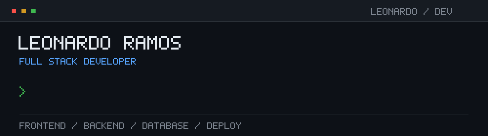

# Olá, eu sou o Leonardo 👋

**Desenvolvedor Full Stack**

Interfaces com React e Tailwind CSS, aplicações com Python e JavaScript,
+bancos de dados com PostgreSQL e SQL — do frontend ao deploy.

## Sobre mim

Sou desenvolvedor full stack e gosto de conectar todas as partes de uma aplicação: uma interface bem cuidada, a lógica no backend e os dados no lugar certo.

- **Frontend:** React, Tailwind CSS, HTML, CSS, JavaScript e TypeScript.
- **Backend e dados:** Python, SQL, PostgreSQL e Supabase.
- **Infraestrutura e deploy:** Docker e Railway.

## Minha stack

**Frontend**

**Backend e banco de dados**

**Infraestrutura**

---

**Vamos conversar sobre tecnologia e projetos?**
+[Me encontre no LinkedIn](https://www.linkedin.com/in/leonardo-ramos-0071b7389/)

